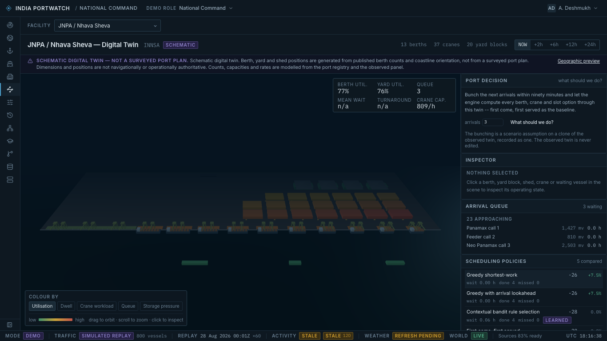
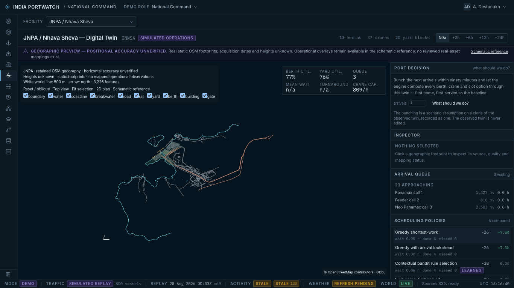

# Pilot validation — October 17, 2026

Base: `c854e60b4404c0763818f49a780bc2764c668450`.
Branch: `feat/ananya-georeferenced-port-twins`.

| Check | Result |
| --- | --- |
| Geometry transformation, catalogue, source integrity and layer tests | 10 passed |
| Frontend TypeScript | Passed |
| Production build | Passed, including node-server browser build |
| ESLint: new geographic files, PortTwinScreen and browser suite | Passed |
| Geographic/browser integration | 7 passed in 44.2 seconds; 1366 × 768 |
| Whitespace diff check | Passed |

Browser checks cover geographic selection, stable selection across layer/horizon
changes, 2D/oblique switching, fit-selection, return to schematic, navigation to
another port, missing assets, WebGL context loss and the four native role entry
screens. The tests use retained API fixtures and test-only server-session/demo
path adapters. They do not access production/private visitor state. Role entry
smoke checks are not an end-to-end advisory/approval workflow certification.

Environment: local macOS, Node 26.5.0, Playwright Chromium 153.0.8010.12,
headless, laptop-1366 project. Node 24 remains the repository CI recommendation;
that exact runtime was not installed for this verification. No FPS measurement
or desktop performance acceptance is claimed. Original raw XML is about 5.5 MiB,
derived catalogue about 3.9 MiB, and the scene contains 3,226 features.

Screenshots use the same 1366 × 768 viewport, JNPA facility, NOW horizon and
retained simulator fixtures:

The first browser attempts were blocked by a missing Chromium install, then by
the shared legacy test harness's outdated session/API path contract. This suite
adapts its test fixtures locally without changing authentication. An inspector
assertion was corrected to compare DOM text consistently. Final run has no
retries and all seven tests pass.

The original PortTwinScene already has repository-wide Prettier discrepancies
and a fast-refresh warning; it received only the additive selection type. Its
unrelated formatting was preserved. Existing build notices about large chunks,
static/dynamic scene imports and Vite plugins remain. Lockfile dependencies were
not upgraded.

Accuracy remains **unverified**: zero independent check points, no registered
reference imagery, null median/p95/max horizontal error and no verified heights.
The metric plan and transformation tests validate import mechanics; they do not
measure the real-world accuracy of OpenStreetMap. See [remaining acceptance
work](README.md#accuracy-and-remaining-acceptance-work).
