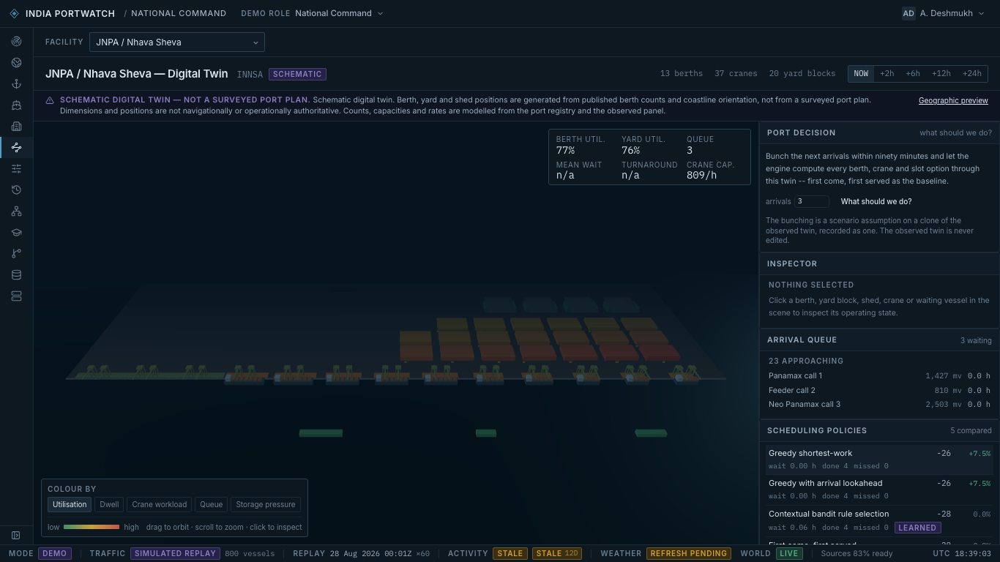
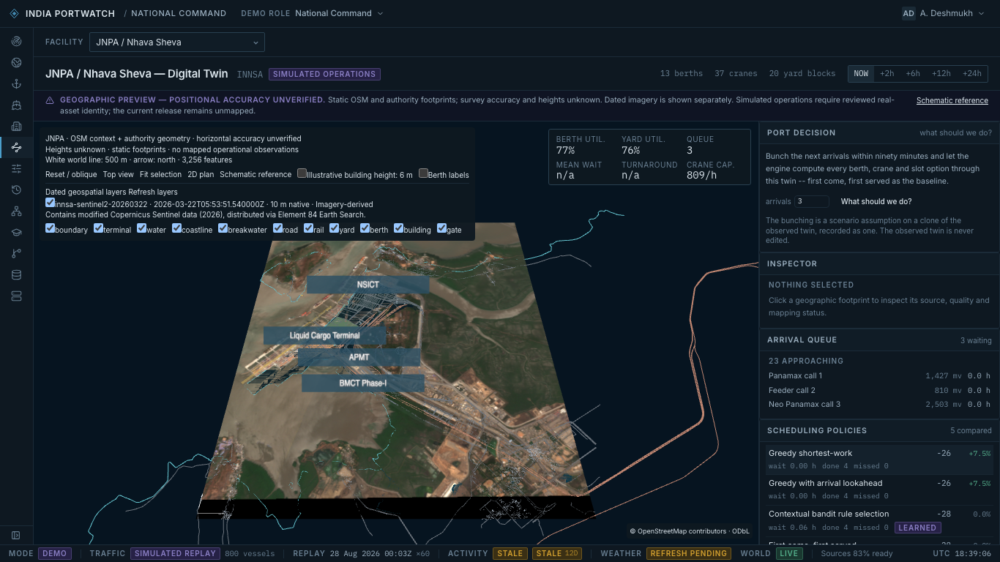

# Verified GEE handoff — October 20, 2026

Branch: `feat/ananya-georeferenced-port-twins`.
Shared base: `c854e60b4404c0763818f49a780bc2764c668450`.
Previous pilot commit: `4b614f0`.

| Check | Result |
| --- | --- |
| Geometry contracts and public API tests | 17 passed |
| TypeScript | Passed |
| Targeted ESLint | Passed |
| Production/node-server build | Passed |
| Browser suite at 1366×768, no retries | 10 passed, 1.3 minutes |
| Native image-window offline reproduction | Same PNG SHA-256 |
| Authority release offline reproduction | Same GeoJSON and layer catalogue bytes |
| Dimension comparison reproduction | Same report bytes from retained plan hash |
| Working HTTP handshake | GET localhost:8001 manifest returned 200 |
| Whitespace check | Passed |

The browser suite covers source-backed geometry, dated imagery controls, expired
and malformed layers, an explicitly synthetic reviewed operational mapping,
horizon changes without geometry rebuild, selection preservation, missing assets,
WebGL loss, 2D/schematic fallbacks, role-entry smoke checks and a recorded orbit
performance sample. The selected-horizon regression verifies that +6h requests
hour 6 and that the mapped inspector reports hour 6; the old fixed 24h request
was corrected in the screen without modifying the simulator. The real release still contains no invented operational
mapping. Four role-entry smoke checks do not certify a complete advisory chain.

The API tests cover manifest/geometry/catalogue/PNG responses, reviewed-unmapped
identity dispositions, unknown ports, bad configurations, offline rebuild,
invalid CRS/assets/dates/resources/resolution and dry-run non-persistence. The
precise public-route predicate is tested to exclude operational twin paths,
arbitrary descendants and write operations. The full production identity store
and collectors were not started for these tests.

The only authentication-related edit is a narrowly scoped public-route
classification for these static geographic GETs and the non-persisting validator.
Existing operational authentication remains in place. The integration owner
should review that small allowlist addition along with backend asset packaging.

The final interaction sample averaged 37.8 FPS over 84 frames with the dated
raster and optional illustrative 6 m building volumes enabled. Median frame
interval was 16.7 ms and p95 66.7 ms. This is headless Chromium 153.0.8010.12 on
macOS/Intel i5-8500 at 1366×768; GPU strings were masked. It is not a claim that
every frame exceeds 30 FPS. Exact measurements: `evidence/performance.json`.

The first release's original scene remains available. Its unrelated existing
formatting and the existing build chunk/plugin notices were preserved. Node
26.5.0 was used locally; Node 24 remains the project's CI recommendation.

The local reference is not a live GEE account integration. A remotely reachable
host/provider catalogue and suitable independent accuracy/identity evidence
remain external acceptance items, documented in `ACCURACY_AND_ACCEPTANCE.md`.
