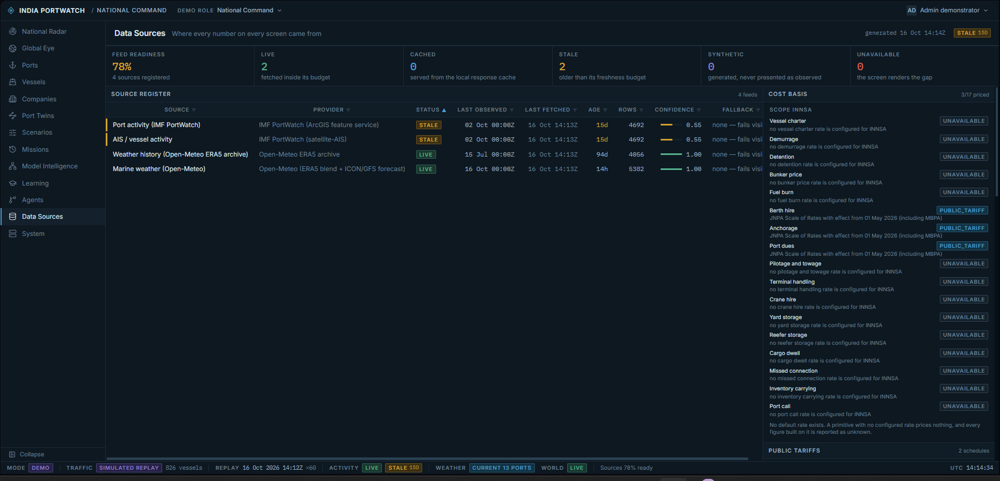
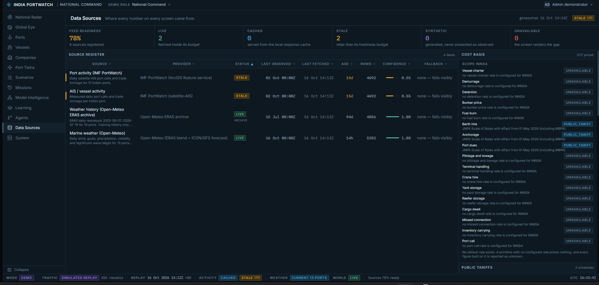
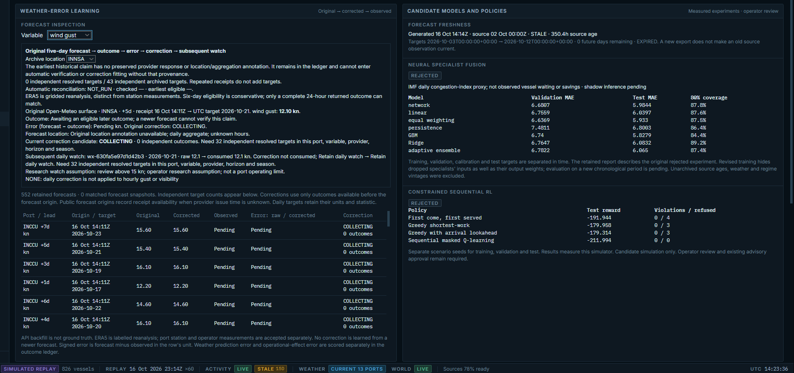
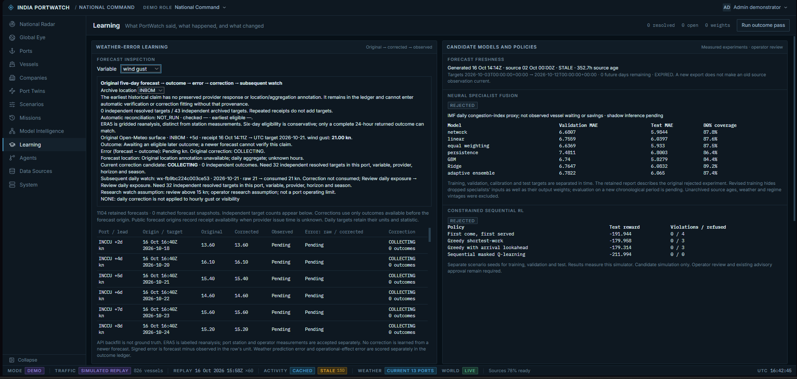

# PortWatch UI and data-quality audit — first pass

Date: 2026-10-16
Branch: `feat/preksha-ui-data-quality`
Scope: milestone 1 role audit and the first reviewable Admin Data / Learning changes.

## Four-role workflow audit

| Demo role | Main journey reviewed | Evidence and data-quality observations |
|---|---|---|
| Vessel Bridge | Find a vessel, inspect its track, replay and forecast lead | `PW Meridian` is explicitly simulated, has no IMO identifier, and its route is labeled non-navigational. Stale port data (15D), a 14.8h predicted berth wait and limited/unknown route weather are visible. The map, layers and timeline remain the primary workflow. |
| Fleet Command | Review fleet exposure and a diversion recommendation | The page shows a fictional carrier, simulated fleet counts, exposed vessels and a diversion evaluation (`233h → INNSA`). The operator should read the proposed diversion as a model evaluation requiring review, not a committed real-world route. |
| Port Authority | Inspect JNPA / Nhava Sheva arrivals, congestion and forecast | Current screen shows `INNSA`, simulated traffic, 138 vessels in the approach, observed congestion 78.4, a Day-1 forecast 79.8 with an 80% band, and 11.8h predicted berth wait. Port activity is marked stale 15D, so the observation age needs to remain legible beside the forecast. |
| National Command / Admin | Inspect national picture, source register and forecast learning | Data Sources showed 4 registered feeds at 78% readiness; Port activity and AIS were stale 15D, ERA5 history was 94d old, marine weather 14h old, and 3/17 cost items were priced. Learning showed zero resolved outcomes, pending claims and rejected candidate models. |

All four roles were opened from the shared Demo Role menu. The menu identifies them as roles in one isolated fictional demo world. The walkthrough reviewed read-only screens and did not issue advisories or commit operational actions. Code review of `/login` confirmed one-click demo buttons for all four roles; the auth provider stores the returned demo session and restores it on reload, and the route guard preserves a requested deep link through login. I did not manually launch a fresh demo session, reload, or use browser Back during this pass. The browser reported new user activity while I was checking it, so I left the live window untouched.

## Selected screens and evidence

Selected the Admin Data source register and Admin Learning forecast inspection. They connect the source's receipt, age and historical/live role to the forecast claim, target date, pending outcome and correction eligibility.

### Admin Data — source register

The screen showed four sources and 78% feed readiness. The ERA5 tooltip read: “ERA5 daily reanalysis 2025-09-07 for 13 ports. Training history only -- the live forecast feed covers everything after this window.” Before the change, that clarification was only on hover. The first inline version squeezed the source column; the final version sets a fixed width, clamps the explanation to two lines and preserves full text in the tooltip. ERA5 now shows `LIVE` fetch status separately from the `Archive` temporal role.

### Admin Learning — weather verification

The screen exposes variable, archive location, receipt and target times, pending outcome, correction status and independent-target counts. The location selector used to reset to INNSA when a variable query reloaded. It now remains selected in the parent panel. The before/after screenshots show the wind-gust inspection with the original location reset vs. the retained INBOM selection.

The screenshots were captured by the operator during the walkthrough. The Admin Data pair uses the same viewport size; the Learning pair uses different viewport sizes, so it documents the state behavior rather than serving as a pixel-level layout comparison.

## Changes in this first pass

- Show source detail below the source name, with a two-line clamp and full text on hover.
- Show `Archive` separately from fetch status, preferring the structured temporal role and retaining a legacy name-based fallback.
- Preserve the selected archive location when changing the Learning variable.
- Add a versioned, additive `SourceQualityDTO` with runtime validation for temporal role, value kinds, operational use, receipt freshness, date coverage, provenance, completeness, issues and reasons for unknown values.
- Enrich the provenance fixture with stale observed-history, archived reanalysis, and mixed historical/forecast examples. Unknown port/variable coverage, original hashes and forecast bounds remain `null` with reasons; the fixture does not invent them.
- Keep old provenance responses working: the new DTO is optional; malformed optional quality metadata is surfaced as a parse reason while the legacy source row remains usable.

## Remaining work from the teammate plan

- Extend the inspectors beyond this first pass so receipt, observation/acquisition time, forecast origin/target, coverage/completeness, provenance and operational use can be compared together.
- Add and review more fixture cases for missing/malformed quality metadata and other provider states.
- Capture a same-viewport Learning before/after pair if pixel-level comparison is required.
- Review back/refresh and the one-click demo entry path separately; these were not part of the read-only role switching walkthrough.
- Prepare the next connected inspector/polish pass after this first reviewable change is reviewed.

## Verification record

- Manual browser review covered the four role journeys and the two selected Admin screens.
- Manually confirmed the Admin Data column stays readable and ERA5 shows `LIVE` plus `Archive`.
- Manually confirmed `INBOM` remains selected after changing Learning to wind gust.
- Code review confirmed the one-click demo entry points and session restoration behavior; live Back/refresh interaction remains unverified.
- Automated test suites were not run. Type checking is recorded separately after this audit note was prepared.
